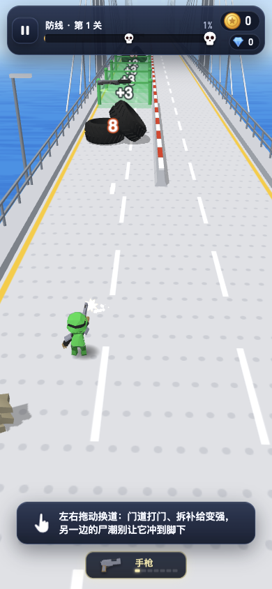

# Army Rush

**Move your squad, shoot number gates to grow your army, and survive zombies and bosses in a 3D browser game.**

Designed for portrait play on phones; also playable on desktop. No client installation required.

**[Play now](https://rem021.github.io/army-rush/)** · [简体中文 / Full guide](README.md) · [Run locally](#run-locally)

<p align="center">
  
  
</p>

Screenshots from the live game: home screen and Defense level 1.

## How to play

1. Open the game and choose **开始战斗** (Start battle). The current game UI is in Chinese.
2. Drag left or right with a finger or mouse. On a keyboard, use the arrow keys or `A` / `D`; press `Esc` to pause.
3. Switch between shooting gates and stopping zombies. Spend coins and diamonds on squad upgrades between battles.

Progress is stored in your browser's localStorage. Clearing site data removes that local progress.

## Modes

| Mode | What you do | Unlock |
| :--- | :--- | :--- |
| Defense / 防线 | Hold the bridge and switch between supply gates and zombies | From the start |
| Rush / 冲锋 | Advance across the bridge and face a boss | From the start |
| Endless / 无尽 | Keep running and record your best distance | Level 2 |
| Firepower / 火力狂潮 | Play a separate fixed-firepower challenge | Clear level 30 in Defense or Rush |

See the [Chinese guide](README.md) for tactics, upgrades, and detailed rules.

## Run locally

Requires Node.js and npm.

```bash
git clone https://github.com/Rem021/army-rush.git
cd army-rush
npm ci
npm run dev
```

Open the address printed by Vite. `npm run build` generates the static site in `dist/`; `npm test` runs the game logic tests.

## Assets and inspiration

Gameplay takes inspiration from Real War: Not Fake and Last War advertisements. Character, zombie, boss, and prop models are by Quaternius under CC0; see [credits and licenses](public/models/CREDITS.md). Other scene elements and sound effects are generated in code.
